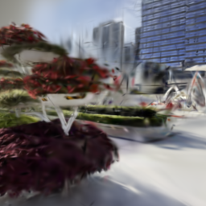
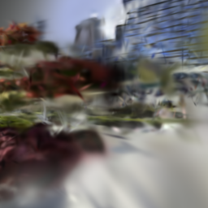
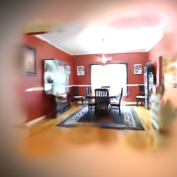
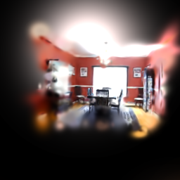
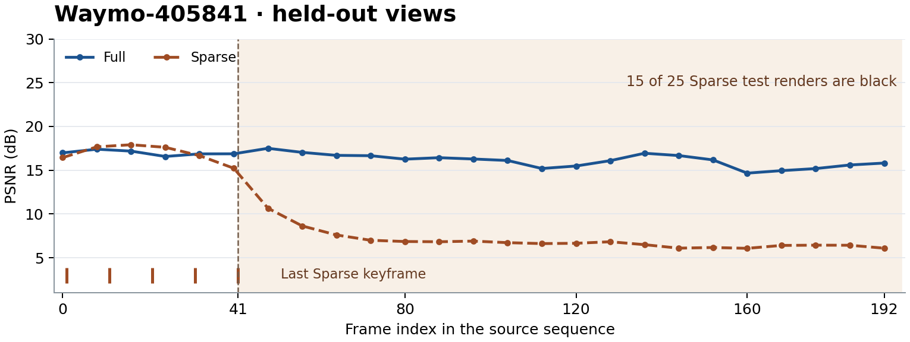

# AIAA 3201 Project 4 · Sparse-View 3D Reconstruction

## Part 2 · Immediate 3D Gaussian Splatting from RGB

This repository records the Option A experiments on DL3DV-2, Re10k-1 and Waymo-405841. [i3dgs](https://github.com/graphdeco-inria/i3dgs/tree/cf4d5b9762359a1d6de76fb9abf7b3dc764c1a42) estimates camera poses and reconstructs a Gaussian scene from RGB images. The Full and Sparse runs use the same held-out test cameras within each scene.

| Scene | Full / Sparse training views | Test views | PSNR ↑ (dB), Full / Sparse | SSIM ↑, Full / Sparse | LPIPS ↓, Full / Sparse |
| --- | ---: | ---: | ---: | ---: | ---: |
| DL3DV-2 | 267 / 11 | 39 | 22.17 / 19.13 | 0.73294 / 0.65670 | 0.32119 / 0.44218 |
| Re10k-1 | 154 / 6 | 23 | 15.36 / 9.93 | 0.55333 / 0.33435 | 0.36100 / 0.55018 |
| Waymo-405841 | 174 / 20 | 25 | 16.30 / 9.32 | 0.61419 / 0.18583 | 0.54756 / 0.68927 |

| Held-out view | Full | Sparse |
| --- | --- | --- |
| DL3DV-2, frame 153 |  |  |
| Re10k-1, frame 50 |  |  |



[Results and interpretation](part2/results/README.md) · [Exact scores and run IDs](part2/results/summary.csv)

## Reproduce Part 2

Run the commands from this repository's root. The official runs used Ubuntu 22.04, an NVIDIA RTX A6000, Python 3.12.16, PyTorch 2.7.1+cu128, and the system CUDA 12.4 compiler. The CUDA runtime and compiler must be compatible with the NVIDIA driver. A CUDA 12.8 toolkit also matches the upstream installation instructions. Git, a C++ toolchain, Ninja and the usual Linux OpenGL libraries (e.g. `libgl1`) are required. [i3dgs setup instructions](https://github.com/graphdeco-inria/i3dgs/blob/cf4d5b9762359a1d6de76fb9abf7b3dc764c1a42/README.md#setup)

### 1. Prepare the course data

Obtain `Project4.zip` from the course. The original archive has SHA-256 `29132c521880783c6e0fe7149503955bf8430a4ebe8a632f8b236abf9900491f`. The CPU-only data setup uses Python 3.12 with the [data requirements](scripts/requirements-data.txt). Use a separate environment for this step.

```bash
python3.12 -m venv .venv/data
source .venv/data/bin/activate
python -m pip install -r scripts/requirements-data.txt
python scripts/prepare_data.py --archive /path/to/Project4.zip
python scripts/preprocess_part1.py
deactivate
```

The shared data preparation detects exact duplicates, reserves every eighth unique image for testing (starting at index 0), and rectifies Waymo RGB to a 960×640 pinhole camera. DL3DV-2 and Re10k-1 retain their original 256×256 RGB images. The [fixed manifest](part2/input_plan.json) lists and hashes every image used. Sparse starts at index 1 of the ordered, deduplicated timeline, then samples once every 10 frames for Waymo and every 30 frames for the other scenes. Test RGB and reference extrinsics are used during evaluation. Waymo calibration is used to rectify the RGB.

```bash
export P2_WORK="$PWD/workspace"
export P2_DATA_ROOT="$PWD/data/raw"
export P2_SRC="$P2_WORK/i3dgs"
mkdir -p "$P2_WORK/staged"
ln -s "$PWD/data/processed/part1/Waymo-405841" "$P2_WORK/staged/Waymo-405841"
```

If you already have the official raw scenes, set `P2_DATA_ROOT` to the directory containing `405841`, `DL3DV-2`, and `Re10k-1`. An existing verified Waymo-405841 preprocessed directory can be linked in the same way. It must contain `train/images`, `test/images`, and `preprocessing.json`.

### 2. Install i3dgs and the reconstruction dependencies

Use a fresh Python 3.12 environment. Choose the correct toolkit path for your system if it is outside the default location. The flags below target a Linux NVIDIA CUDA setup.

```bash
conda create -n aiaa3201-p2 python=3.12 pip -y
conda activate aiaa3201-p2
git clone https://github.com/graphdeco-inria/i3dgs.git "$P2_SRC"
git -C "$P2_SRC" checkout --detach cf4d5b9762359a1d6de76fb9abf7b3dc764c1a42
git -C "$P2_SRC" submodule update --init --recursive
source part2/use-part2.sh

python -m pip install --index-url https://download.pytorch.org/whl/cu128 \
  torch==2.7.1 torchvision==0.22.1
python -m pip install 'setuptools<81' wheel ninja hatchling hatch-vcs
python -m pip install --index-url https://download.pytorch.org/whl/cu128 xformers==0.0.31
python -m pip install --no-build-isolation -c part2/constraints-gpu.txt \
  meshio tqdm opencv-python lpips addict kornia joblib timm cupy-cuda12x \
  'depth-anything-3 @ git+https://github.com/ByteDance-Seed/Depth-Anything-3.git@40674546e40144452ec93035ac77d762f4b5d16f' \
  'fused-ssim @ git+https://github.com/rahul-goel/fused-ssim.git@a7c48d6dd7ac6dc39a7958c7c4452e0b10418f38' \
  'graphdecoviewer @ git+https://github.com/graphdeco-inria/graphdecoviewer.git@e38ebe5b1aa663a0cb3e1f06a2383f9128ef56b4' \
  "$P2_SRC/submodules/diff-gaussian-rasterization" "$P2_SRC/submodules/simple-knn"
python -m pip check
(cd "$P2_SRC" && python train.py --help)
```

The archived runs used the same i3dgs revision and [fixed image manifest](part2/input_plan.json). The published runner makes data and cache locations configurable and keeps the experiment arguments. See [results notes](part2/results/README.md) for the two compatibility fixes and remaining reproduction checks.

### 3. Obtain and verify the model weights

```bash
python part2/fetch_weights.py
```

The [download manifest](part2/weights.json) gives the official URLs, destination paths, and SHA-256 digests. The DA3-BASE config accepts either the upstream or the archived byte serialization of the same JSON. For servers with restricted outbound access, download on a connected machine, transfer files to the listed paths, then run `python part2/fetch_weights.py --check`.

| Dependency | Purpose | Destination |
| --- | --- | --- |
| [DA3-BASE](https://huggingface.co/depth-anything/DA3-BASE) | Initial depth and geometry | `$P2_WORK/weights/DA3-BASE/` |
| [MegaLoc](https://huggingface.co/gberton/MegaLoc) | Retrieve candidate matching views | `$P2_WORK/weights/MegaLoc/` |
| [XFeat and LighterGlue](https://github.com/verlab/accelerated_features/tree/e92685f57f8318b18725c5c8c0bd28c7fe188d9a/weights) | Local feature extraction and matching | `$P2_WORK/weights/torch/hub/checkpoints/` |
| [Depth Anything V2 Small](https://huggingface.co/depth-anything/Depth-Anything-V2-Small) | Monocular depth cues | `$P2_SRC/models/depth_anything_v2_vits.pth` |
| [TorchVision VGG16](https://docs.pytorch.org/vision/stable/models/generated/torchvision.models.vgg16.html) | LPIPS evaluation | `$P2_WORK/weights/torch/hub/checkpoints/vgg16-397923af.pth` |

### 4. Reconstruct and evaluate

```bash
source part2/use-part2.sh
bash part2/run_reconstruction.sh DL3DV-2 full
bash part2/run_reconstruction.sh DL3DV-2 sparse
```

Use the two `run.*` directory names printed by the runner, in Full/Sparse order. The evaluator's name is retained from the first experiment. It accepts all three scenes through `--scene`.

```bash
python -u part2/evaluate_dl3dv.py --scene DL3DV-2 run.FULL_ID run.SPARSE_ID
```

Repeat with `Re10k-1` and `Waymo-405841`. Each invocation creates a new output folder under `$P2_WORK/runs/part2/<scene>/`. Successful reconstruction saves `model/hierarchy.ply`, `model/metadata.json`, and registered cameras. Evaluation saves pose alignment, all held-out renders, and PSNR, SSIM, and LPIPS-VGG scores per image and per run.

## View a saved 3D scene

Keep the entire `model/` folder from the run you want to show. The i3dgs viewer loads the Gaussian representation and renders it from the camera position and orientation you choose.

```bash
cd "$P2_SRC"
python gaussianviewer.py local /path/to/run/model
# To use a remote GPU with an SSH port forward, run on the GPU host:
python gaussianviewer.py server /path/to/run/model --ip 127.0.0.1 --port 6009
```

Forward local port 6009 to the host's port 6009 over SSH. From a local Python environment with the upstream graphdecoviewer package installed, run `python gaussianviewer.py client --ip 127.0.0.1 --port 6009` from the i3dgs checkout. The GPU host renders the scene and streams images to the client. The viewer uses the saved model and rendering dependencies. Raw photos and reconstruction weights are used when computing a new reconstruction, and VGG16 is used when scoring it. [Upstream viewer setup](https://github.com/graphdeco-inria/i3dgs/blob/cf4d5b9762359a1d6de76fb9abf7b3dc764c1a42/README.md#visualizing-a-reconstructed-scene)

## Credits

This course experiment uses [Immediate 3D Gaussian Splatting by Meuleman et al.](https://arxiv.org/abs/2607.14481) and its [research license](part2/upstream-licenses/i3dgs.md). Additional dependencies retain their upstream terms. The example renders and metrics draw on the course scenes from [DL3DV-10K](https://dl3dv-10k.github.io/DL3DV-10K/), [RealEstate10K](https://google.github.io/realestate10k/), and the Waymo Open Dataset.

This work was made using the Waymo Open Dataset, provided by Waymo LLC under the Waymo Dataset License Agreement for Non-Commercial Use, and access and use of the work are governed by that agreement. [Waymo dataset terms](https://waymo.com/open/terms/)
